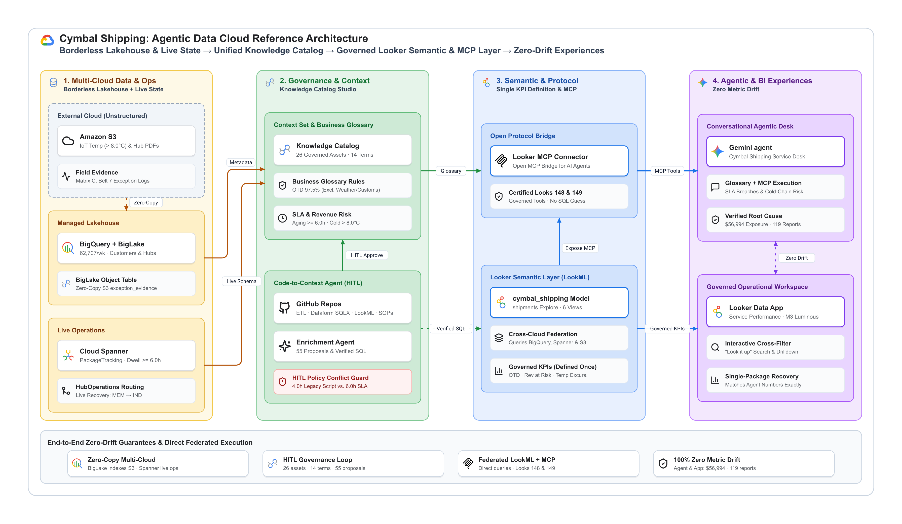

# Cymbal Shipping — Borderless Lakehouse, Knowledge Catalog & Governed Gemini Agent

The biggest bottleneck in enterprise AI is not model intelligence. It is metric drift.

Ask an ungrounded LLM for "on-time delivery" or "revenue at risk" against raw operational tables, and it will happily write plausible SQL that gives three different answers to three different VPs — penalizing your Denver hub for a Rocky Mountain snowstorm or double-counting refunds on non-guaranteed ground freight. That is what happens when you bolt AI onto disconnected data silos and pray the semantics hold together.

This repository is the runnable, end-to-end **Cymbal Shipping** reference architecture built on Google Cloud. It wires a live logistics disruption — a sort line outage on Matrix C, Belt 7 at the Memphis SuperHub — across analytical history in **BigQuery**, real-time operational state in **Cloud Spanner**, unstructured cold chain logs from **Amazon S3**, a single governed **LookML** semantic layer, **Knowledge Catalog**, a **Looker Data App** (Toolkit 1.3.0), and a **Gemini agent**. Every surface reads the same governed definitions, so the executive app, the native BI dashboard, and the conversational agent return the exact same number to the penny.

| The Old Way (Siloed BI + Bolted-On AI) | The New Way (Governed Agentic Data Cloud) |
| :--- | :--- |
| Separate analytical and operational islands with brittle batch ETL | **Borderless Lakehouse:** BigQuery history, Cloud Spanner live scans, and Amazon S3 field reports unified under one semantic explore |
| Business definitions trapped in tribal wikis and stale Python scripts | **Knowledge Catalog:** 14-term Business Glossary, 26-entry Context Set, and a 55-proposal Enrichment Agent that flags code-vs-policy drift |
| Unconstrained text-to-SQL generating false alarms on weather delays | **Governed Semantic Grounding:** LookML enforces controllable vs. excused delays so the **Gemini agent** never hallucinates a KPI |
| Static dashboard dead-ends | **AI Power Meets UI Control:** Look-it-up search, double-check verification marks, full cross-filtering, and one-click package recovery |

---

## Architecture & Blueprint



- **Executive & Field Blueprint:** [`./docs/BLUEPRINT.md`](./docs/BLUEPRINT.md)
- **Ground-Truth Technical Catalog (exact DDL, columns, row counts, LookML measures, and golden benchmarks):** [`./docs/SCHEMA_AND_DATA_SHAPE.md`](./docs/SCHEMA_AND_DATA_SHAPE.md)

### What the live scenario proves (by the numbers)
- **883,919 packages** across 36 named accounts, 10 sort hubs, and 8 services (`62,707` shipped this week), frozen at a deterministic snapshot (`2026-11-11 8:00 AM ET`).
- **55,922 live in-network packages** tracked in Cloud Spanner (`cymbal_shipping_ops.PackageTracking` + `ShippingNetwork` Property Graph), surfacing `3,304` aging packages (`>= 6.0` hours dwell) this week.
- **863 unstructured field evidence documents** (`614,678` bytes) read through an external object table (`field_evidence_objects`), exposing `65` cold chain temperature excursions above `8.0°C`.
- **Zero metric drift:** Following Monday night's Memphis SuperHub outage, Priority Overnight On-Time Delivery drops from `98.7%` to **`73.3%`** against the `97.5%` target, exposing **`$343,270`** in network Revenue at Risk and holding **`385` Strategic healthcare cold chain packages** (`$56,994` at risk, `34` temperature excursions across Meridian Pharma, Aurora Biologics, and Northstar Medical Devices).
- **Governance caught before it hits an executive:** The Knowledge Catalog Enrichment Agent crawls 6 repo files (Python ETL, Dataform SQLX, SQL views, ISO GQL, and SOP Markdown) and catches three legacy script conflicts — a `4.0`-hour dwell threshold, unexcused weather delays, and a `7.5°C` ceiling — before proposing updates for human-in-the-loop review.

---

## Repository Layout

```text
.
├── .env.example                    # All GCP, Looker, Knowledge Catalog & Gemini agent env vars
├── lib/gcp.py                      # Zero-dependency stdlib REST helpers for GCP & Looker APIs
├── 01_data/                        # BigQuery lakehouse, Cloud Spanner + Property Graph, GCS/Object Table
│   ├── 01_seed_bigquery.py
│   ├── 02_tracking_and_evidence.py
│   └── 03_spanner_and_lake.py
├── 02_lookml/                      # Governed LookML project + native Looker dashboard & 2 Saved Looks
│   ├── cymbal_shipping/            # manifest.lkml, model, and 6 governed views
│   ├── deploy_lookml.py
│   └── 07_native_looker_dashboard.py
├── 03_looker_data_app/             # Looker Data Apps Toolkit 1.3.0 custom web component
│   ├── app.js
│   └── README.md
├── 04_knowledge_catalog/           # 14-term Glossary, 26-entry Context Set, 55-proposal Enrichment Agent
│   ├── kc_terms.py
│   ├── 04_wire_knowledge_catalog.py
│   ├── 06_catalog_app_and_agent.py
│   ├── 08_catalog_looker_environment.py
│   ├── 11_deploy_cymbal_shipping_enrichment_agent.py
│   └── enrichment_sources/         # 6 multi-category code & SOP files (Python, SQLX, SQL, GQL, MD)
├── 05_gemini_agent/                # Governed Gemini agent deployment, connector bindings & prompt bank
│   ├── agent_instruction.txt
│   ├── 05_deploy_gemini_agent.py
│   ├── 09_fix_agent_tools.py
│   ├── 10_republish_agent.py
│   └── prompts.md
├── diagrams/                       # Architecture diagram output folder
└── docs/
    ├── SCHEMA_AND_DATA_SHAPE.md    # Verified ground-truth technical catalog
    └── BLUEPRINT.md                # GTM & technical blueprint (added by producer)
```

---

## Prerequisites

1. **Google Cloud project** with billing enabled and the following APIs active: BigQuery, BigQuery Connection, Cloud Spanner, Cloud Storage, Dataplex (Knowledge Catalog), and Discovery Engine.
2. **Looker Core instance** with API credentials (`LOOKER_CLIENT_ID`, `LOOKER_CLIENT_SECRET`), a BigQuery database connection (`default_bigquery_connection` or custom name), Looker Data Apps Toolkit 1.3.0 enabled, and Knowledge Catalog metadata sync turned on.
3. **Gemini agent app / engine** configured with a Looker MCP data connector (and optional BigQuery / Spanner connectors).
4. **Python 3.10+** and authenticated `gcloud` CLI (`gcloud auth login && gcloud auth application-default login`). Zero external `pip` packages are required — every script uses the Python standard library.

---

## Step-by-Step Setup

### 0. Configure environment variables

```bash
cp .env.example .env
# Edit .env with your GCP_PROJECT_ID, GCP_PROJECT_NUMBER, LOOKER_*, and GEMINI_* values.
```

### 1. Stand up the data layer (BigQuery + Cloud Spanner + Object Table)

```bash
python3 01_data/01_seed_bigquery.py
python3 01_data/02_tracking_and_evidence.py
python3 01_data/03_spanner_and_lake.py spanner gcs
# Optional: enable zero-copy BigQuery-to-Spanner external dataset federation
python3 01_data/03_spanner_and_lake.py federate
```

### 2. Deploy the governed LookML model, native dashboard, and Saved Looks

```bash
python3 02_lookml/deploy_lookml.py
python3 02_lookml/07_native_looker_dashboard.py
```

This deploys the `cymbal_shipping` model, validates LookML, runs a production smoke query, builds the 14-tile cross-filtered native dashboard, and creates the two governed Saved Looks (writing `native_looker_content.json` locally for Step 4).

### 3. Deploy the Looker Data App (Toolkit 1.3.0)

Follow [`03_looker_data_app/README.md`](./03_looker_data_app/README.md) to publish `03_looker_data_app/app.js` to your Looker instance, then set `LOOKER_DATA_APP_DASHBOARD_ID` in `.env`.

### 4. Wire Knowledge Catalog & upload Enrichment Agent signals

```bash
# Pass 1: 14-term Business Glossary, overviews, Amazon S3 catalog entries, links, and 21 core Context Set entries
python3 04_knowledge_catalog/04_wire_knowledge_catalog.py

# Upload the 6 Python/SQLX/SQL/GQL/SOP enrichment files to GCS for Knowledge Studio
python3 04_knowledge_catalog/11_deploy_cymbal_shipping_enrichment_agent.py upload
python3 04_knowledge_catalog/11_deploy_cymbal_shipping_enrichment_agent.py print-config
```

### 5. Deploy, bind, and publish the Gemini agent

```bash
python3 05_gemini_agent/05_deploy_gemini_agent.py
# Copy the printed agent ID into GEMINI_AGENT_ID in .env, then bind connectors by tag and publish:
python3 05_gemini_agent/09_fix_agent_tools.py apply looker --instruction 05_gemini_agent/agent_instruction.txt
python3 05_gemini_agent/10_republish_agent.py publish
```

### 6. Complete the Knowledge Catalog lineage graph (26-entry Context Set)

```bash
# Pass 2: Catalog the Looker Data App and Gemini agent (+2 Context Set entries -> 23)
python3 04_knowledge_catalog/06_catalog_app_and_agent.py "$LOOKER_DATA_APP_DASHBOARD_ID"

# Pass 3: Enrich native Looker dashboard, tiles, and Saved Looks (+3 Context Set entries -> 26)
python3 04_knowledge_catalog/08_catalog_looker_environment.py
```

### 7. Run the hero prompts

Open the **Cymbal Shipping Service Desk** Gemini agent and run the verified prompts in [`05_gemini_agent/prompts.md`](./05_gemini_agent/prompts.md). Compare every percentage and dollar figure side-by-side with the Looker Data App — same definitions, same model, zero drift.
