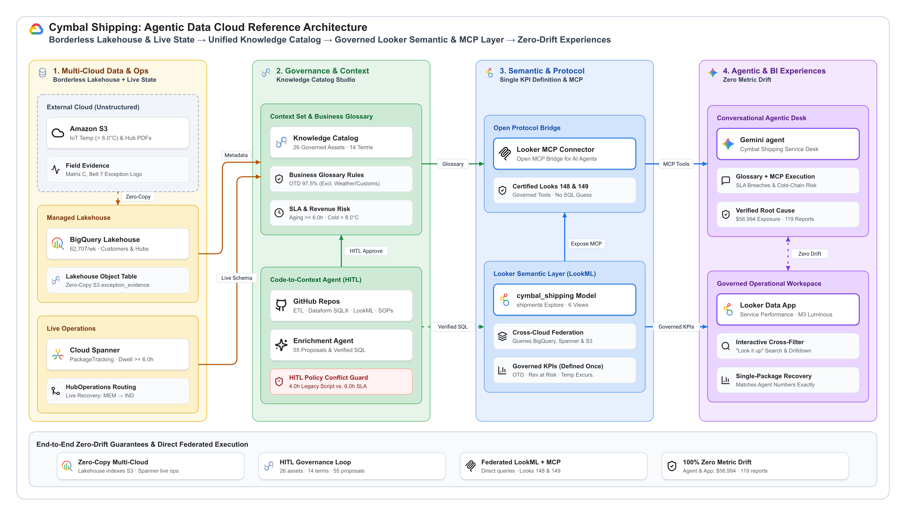

# Cymbal Shipping: Agentic Data Cloud Demo Blueprint

**Author:** Sean Zinsmeister (szinsmeister@google.com)   **Audience:** Solutions GTM & Customer Engineering   **Code:** [github.com/szinsmeister-google/cymbal-shipping-demo](https://github.com/szinsmeister-google/cymbal-shipping-demo)

The biggest bottleneck in enterprise AI is not model intelligence. It is trust. Point a raw text-to-SQL chatbot at a logistics warehouse during a hub outage, and it will happily generate plausible, confident, completely wrong numbers—counting weather delays as SLA breaches, using a stale four-hour threshold from an old script, and contradicting the dashboard sitting open on the VP's other monitor.

We built Cymbal Shipping as a complete, runnable blueprint for the Agentic Data Cloud so Solutions GTM teams do not have to sell this pattern with slides. Every BigQuery table, Cloud Spanner graph edge, Knowledge Catalog glossary term, LookML measure, Looker Data App component, and Gemini agent prompt lives as deployable code in the companion GitHub repository.

## The business story in one breath

Monday night, a sort line (Matrix C, Belt 7) jammed at Cymbal Shipping's Memphis SuperHub. Network on-time delivery dropped from 98.4% to 88.5% across 62,707 weekly packages, putting $343,270 of guaranteed shipping revenue at risk and holding 385 Strategic healthcare cold-chain packages over six hours—with 34 temperature excursions above 8.0°C.

That single operational crisis forces every layer of the data stack to answer the same question at the same time. Which accounts are exposed, how much refund liability sits on the table, what broke on the sort floor, and where do we divert the freight?

| The Old Way (Legacy Compromise) | The New Way (Agentic Data Cloud) |
| :--- | :--- |
| Fragmented database zoo separating operational "now" from analytical "then" | Unified multi-cloud federation across Amazon S3, BigQuery Lakehouse, and Cloud Spanner |
| Business logic trapped in tribal wikis and conflicting GitHub scripts | Knowledge Catalog Enrichment Agent crawls code and flags conflicts for human review |
| Unconstrained text-to-SQL agents inventing their own metric math | Gemini agent reads governed glossary terms and executes LookML measures via Looker MCP |
| Chatbots and BI dashboards contradicting each other in executive meetings | One semantic contract powering both conversational AI and the Looker Data App with zero drift |

## Reference architecture

Every component in this demo maps to four decoupled layers: multi-cloud data and operational state, unified context and governance, a single semantic and protocol contract, and business-ready experiences. You cannot govern what you do not store, and you cannot trust an agent that skips the semantic layer.



*Four-layer Agentic Data Cloud blueprint connecting Amazon S3 field evidence, BigQuery Lakehouse, Cloud Spanner live tracking, Knowledge Catalog governance, Looker LookML over MCP, the Gemini agent, and the Looker Data App.*

- **Layer 1 (Multi-cloud data and live operations):** Amazon S3 stores unstructured cold-chain temperature logs and hub exception notes. BigQuery Lakehouse indexes those files with zero data copies alongside 883,919 historical shipments, while Cloud Spanner tracks 55,922 live undelivered packages and hub recovery lanes.
- **Layer 2 (Unified governance and context):** Knowledge Catalog binds 26 cross-cloud assets and 14 business glossary terms into one Context Set. Its Enrichment Agent crawls engineering GitHub repos, extracts 55 governed proposals, and catches a hidden four-hour legacy script conflict in Human-in-the-Loop review.
- **Layer 3 (Governed semantics and open protocol):** A single LookML model (cymbal_shipping) defines all 22 operational and financial KPIs once across BigQuery, Spanner, and S3. The Looker MCP connector exposes those governed measures and certified Looks directly to AI agents.
- **Layer 4 (Zero-drift experiences):** Both the Gemini agent (Cymbal Shipping Service Desk) and the Looker Data App (Service Performance) run against the exact same semantic layer. Ask either surface about Strategic healthcare exposure in Memphis, and both return Meridian Pharma at $27,888 down to the exact dollar.

## Data shape and schema design

Toy 12-row tables kill executive credibility in thirty seconds. We designed the synthetic dataset deterministically (using FARM_FINGERPRINT in BigQuery so every rebuild produces identical numbers) spanning 41 ship days from October 1 through November 10, 2026, frozen at an operational snapshot of Wednesday, November 11, 2026 at 8:00 AM Eastern.

Three realistic incidents sit inside the data to test whether the semantic layer actually enforces policy: the controllable Memphis sort-line outage (Nov 9–10, dropping Memphis Priority Overnight from 98.7% to 73.3%), a Denver mountain snowstorm (Oct 27–28, excused as weather so official on-time rate holds at 98.3% while raw on-time drops to 89.0%), and a Newark weather event (Oct 13, also excused).

### BigQuery analytical lakehouse (cymbal_shipping)

Six native BigQuery tables and one Lakehouse external object table form the analytical core in region us-east1. Every table is seeded idempotently by the scripts in folder 01_data of the GitHub repository.

| Table or object | Partitioning and clustering | Verified rows | Role in the demo |
| :--- | :--- | ---: | :--- |
| hubs | None (10 columns) | 10 | Sort hubs, daily capacities (190k–1.45M), and assigned recovery hubs (MEM to IND) |
| services | None (8 columns) | 8 | Eight shipping tiers (PO, SO, 2D, ES, IP guaranteed; Ground, Home, Freight non-guaranteed) |
| customers | None (9 columns) | 36 | Named enterprise accounts across 5 verticals, 4 tiers, and named Account Directors |
| shipments | Partition: ship_date; Cluster: routing_hub_code, customer_id, service_code | 883,919 | Package-level system of analysis: pickup, commit deadline, delay category, and billed revenue |
| live_package_tracking | Cluster: current_hub_code, package_status | 55,922 | Analytical replica of active undelivered packages, hub dwell hours, aging flag, and recovery plan |
| exception_evidence | None (14 columns) | 863 | Extracted structured facts and full text from unstructured field reports, including 65 temp excursions |
| field_evidence_objects | Lakehouse External Object Table | 863 files (614 KB) | Zero-copy object table indexing the lakehouse landing copy of Amazon S3 field evidence documents |

The shipments table carries 23 columns including tracking_number (12-digit unique key), is_cold_chain (Healthcare 2–8°C shipments on PO, SO, or IP), exception_reason, exception_category (Controllable vs. Uncontrollable), service_outcome, and is_guarantee_refund_eligible. Because those flags are computed deterministically, every downstream chart and agent query resolves cleanly without fragile client-side SQL.

### Cloud Spanner operational state and property graph

Historical warehouse tables cannot tell a hub director which packages are sitting on a stalled belt right now. Cloud Spanner (instance cymbal-shipping-ops, database cymbal_shipping_ops, 100 processing units) stores the operational "now" across three tables and one ISO GQL Property Graph, exposed zero-copy to BigQuery via external schema cymbal_shipping_ops_spanner.

- **Hubs (10 rows):** Live hub status (Memphis set to Recovering, all other 9 hubs Normal), real-time held package counters, and cold-chain hold counters.
- **PackageTracking (55,922 rows):** Every undelivered package in the network, indexed by PackageTrackingByHub (current_hub_code, package_status), tracking hub_dwell_hours, the six-hour is_aging flag, and the operational recovery_plan.
- **RecoveryLanes (10 rows):** Diversion lanes between hubs, with Memphis to Indianapolis marked Active (next departure Tonight 10:40 PM CT) and the remaining nine lanes on Standby.
- **ShippingNetwork Property Graph:** Connects Hub nodes via RECOVERS_VIA edges so operational apps and agents can traverse backup routing directly in Spanner.

```sql
CREATE PROPERTY GRAPH ShippingNetwork
  NODE TABLES (
    Hubs KEY (hub_code) LABEL Hub
      PROPERTIES (hub_code, hub_name, sort_status,
                  packages_held, cold_chain_packages_held)
  )
  EDGE TABLES (
    RecoveryLanes KEY (from_hub_code, to_hub_code)
      SOURCE KEY (from_hub_code) REFERENCES Hubs (hub_code)
      DESTINATION KEY (to_hub_code) REFERENCES Hubs (hub_code)
      LABEL RECOVERS_VIA
      PROPERTIES (lane_status, next_departure_local,
                  packages_diverted)
  );
```

### Borderless lakehouse unstructured field evidence (Amazon S3)

Field evidence—IoT temperature logger files, hub delay notices, damage reports, and customs holds—originates in Amazon S3 under s3://cymbal-shipping-field-evidence/ across three prefixes: hub-delay-notices, cold-chain-temperature-logs, and driver-and-customs-reports. BigQuery Lakehouse indexes all 863 files (614,678 bytes) through the external object table field_evidence_objects, while exception_evidence exposes extracted root causes (such as Sort line outage Matrix C, Belt 7) and peak sensor readings (max_temperature_c and minutes_out_of_range) for SQL and LookML joins.

## Knowledge Catalog setup and code-to-context enrichment

Putting raw schemas in front of an LLM without business rules is how teams end up debugging hallucinations in production. We built three layers inside Knowledge Catalog Studio (region us-east1) using the scripts in folder 04_knowledge_catalog.

### 1. Business glossary (cymbal-shipping-glossary, 14 governed terms)

Every business phrase a shipper or operations leader uses in conversation is defined once and linked directly to its implementing columns across Looker, BigQuery, and Spanner (22 column-level definition links plus one entry-level link to the S3 bucket).

| Glossary term | Official governed rule | Implementing field |
| :--- | :--- | :--- |
| On-Time Delivery Rate | Target 97.5%; excludes delays outside our control (weather, customs, recipient unavailable, address correction) | shipments.on_time_delivery_rate |
| Revenue at Risk | Billed shipping charges on guaranteed services delayed for controllable reasons | shipments.revenue_at_risk |
| Service Guarantee | Money-back promise covering 5 Express and International services (excludes Ground, Home, Freight) | services.is_guaranteed_service |
| Aging Package | Package held at a hub for 6.0 hours or more in live Spanner tracking | live_package_tracking.is_aging |
| Cold Chain Shipment | Temperature-controlled Healthcare shipment requiring 2–8°C handling | shipments.is_cold_chain |
| Temperature Excursion | Cold-chain sensor reading exceeding 8.0°C in field logger evidence | exception_evidence.is_temperature_excursion |
| Recovery Hub | Designated backup hub absorbing diverted overflow (for example, Memphis to Indianapolis) | hubs.backup_hub_code |

Seven additional glossary terms cover Commit Time, Delay Within Our Control, Delay Outside Our Control, Missed Sort, Strategic Account, Revenue per Package, and Field Evidence.

### 2. Unified Context Set (cymbal-shipping-context-set, 26 entries)

The Context Set scopes what agents are allowed to read and renders the interactive Context Graph in Knowledge Studio. It brings together 7 BigQuery tables and object tables, 4 core Looker semantic entries (Explore plus key views), 2 Cloud Spanner operational tables, 1 Amazon S3 bucket, 7 headline glossary terms, the Looker Data App, the Gemini agent, the native Looker dashboard, and 2 certified Saved Looks—wired together with 7 schema-join links and cross-system reference edges.

### 3. GitHub Code-to-Context Enrichment Agent (55 proposals and HITL guard)

Manual data stewardship does not scale. Most real business logic already lives in engineering GitHub repositories—buried inside Python ETL pipelines, Dataform SQLX marts, SQL views, graph definitions, and operations SOPs.

We configured the Knowledge Catalog Enrichment Agent against six source files (packaged in 04_knowledge_catalog/enrichment_sources/) spanning Python pipelines, Dataform SQLX, BI SQL views, ISO GQL, and policy SOPs. The agent generated 55 structured proposals (35 Document entries, 6 Index entries, and 14 Entry links) plus verified GoogleSQL templates—and caught three live conflicts between a legacy dispatch script and official policy before any agent could touch them:

- **Aging dwell threshold:** Caught legacy script constant 4.0 hours vs. governed Service Guarantee policy of 6.0 hours.
- **Weather delay counting:** Caught legacy flag counting weather delays as SLA breaches vs. governed policy excusing weather and customs.
- **Cold-chain ceiling:** Caught legacy warning threshold of 7.5°C vs. FDA and Healthcare SOP excursion ceiling of 8.0°C.

> **Demo operator note:** Leave the Enrichment Run in "Needs review" status during live briefings—do not click Approve (55) or Deny—so the Human-in-the-Loop discrepancy review stays intact for every customer session.

## LookML semantic layer and Looker Data App

Looker is the deterministic math engine for both human operators and AI agents. Folder 02_lookml holds the complete cymbal_shipping LookML project: one model, one unified shipments Explore joining customers, services, hubs, live_package_tracking, and exception_evidence, and 22 governed measures.

The official On-Time Delivery Rate formula lives in exactly one place: 1.0 minus SAFE_DIVIDE of controllable late packages by packages past commit time. Raw unadjusted on-time rate sits beside it as a separate measure so operators can inspect the impact of weather without polluting the executive KPI.

On top of that exact model, we built two governed BI surfaces:

- **Looker Data App (03_looker_data_app/app.js, Toolkit 1.3.0):** A single-file Material 3 Luminous web component styled with familiar parcel-carrier colors so FedEx business users immediately feel at home. It includes interactive cross-filtering across all five charts, a "Look it up" natural-language bar with one-click prompt chips, embedded glossary definitions, and a single-package tracking drawer (demo hero package 7815 4378 2857 held 31.5 hours at 11.1°C, ready for Indianapolis recovery).
- **Native Looker Dashboard and Saved Looks (02_lookml/07_native_looker_dashboard.py):** A 14-tile cross-filtered native dashboard plus two certified Saved Looks—Priority Overnight OTD by Hub and Strategic Healthcare Cold Chain Aging at Memphis—that the Gemini agent can invoke directly via Looker MCP.

## Gemini agent design and verified proof ledger

Folder 05_gemini_agent contains the low-code Gemini agent (Cymbal Shipping Service Desk, running on gemini-2.5-flash) and its instruction contract (agent_instruction.txt). The instruction follows four strict guardrails that eliminate metric drift:

1. **Glossary first:** Look up business terms in Knowledge Catalog before running any query, and never invent a threshold.
2. **Looker only for numbers:** Execute governed measures through the Looker MCP connector on model cymbal_shipping, explore shipments—never run ad-hoc SQL directly against raw BigQuery or Spanner tables.
3. **Saved Looks first:** Check certified Looks before constructing custom Explore queries.
4. **Show your work:** Close every answer with a one-line "How this was measured" citation naming the Knowledge Catalog glossary definitions and data systems used.

> **Engineering gotcha:** After wiring or updating low-code connector bindings (Looker MCP and BigQuery Knowledge Catalog), always run both deployLowCode and publish (script 10_republish_agent.py). Skipping publish leaves the live chat UI pinned to the previous revision without active tools.

Every surface—Knowledge Catalog, Gemini agent, Looker Data App, and Native Dashboard—reconciles to these exact verified benchmark numbers for the November 11 snapshot:

| Benchmark slice | Verified metric | Underlying sources |
| :--- | :--- | :--- |
| Network topline (This week) | 62,707 packages, 88.5% OTD (down 9.9 pts from 98.4%), $343,270 revenue at risk, 3,304 aging, 65 excursions | BigQuery, Spanner, Amazon S3 via Looker |
| Priority Overnight OTD breaches | Memphis SuperHub 73.3% (down from 98.7%), Anchorage Gateway 94.9% (98 pkgs); other 8 hubs 98.2%–99.0% | Certified Look 148 (Target 97.5%) |
| Strategic healthcare cold-chain aging at Memphis | 385 packages, $56,994 at risk, 34 excursions: Meridian Pharma ($27,888, 202 pkgs, 20 excursions, 11.1°C), Aurora Biologics ($21,231, 147 pkgs, 7 excursions), Northstar Medical ($7,875, 36 pkgs, 7 excursions) | Certified Look 149 (BigQuery + Spanner + S3) |
| Field evidence root cause and recovery | Sort line outage (Matrix C, Belt 7) across 119 Strategic healthcare field reports (215 total); designated recovery hub Indianapolis Air Hub (IND, 98.7% OTD) | Amazon S3 exception_evidence + Spanner ShippingNetwork |
| Hero single-package drill-down | Tracking 7815 4378 2857 (Meridian Pharma): 31.5 hrs dwell, 11.1°C excursion, $184.50 at risk, priority re-ice via Indianapolis | Looker Data App Look-it-up drawer |

## Build this yourself (step-by-step from GitHub)

Clone the repository at [github.com/szinsmeister-google/cymbal-shipping-demo](https://github.com/szinsmeister-google/cymbal-shipping-demo), copy the environment template to your local .env file, and run the five numbered stages in order. Each script is idempotent and reads configuration strictly from environment variables—zero hardcoded project IDs or credentials.

```bash
git clone https://github.com/szinsmeister-google/cymbal-shipping-demo
cd cymbal-shipping-demo
cp .env.example .env && source .env

# 1. Seed BigQuery, Spanner Property Graph, and Lakehouse S3 objects
python3 01_data/01_seed_bigquery.py
python3 01_data/02_tracking_and_evidence.py
python3 01_data/03_spanner_and_lake.py

# 2. Deploy LookML model, native dashboard, and Saved Looks
python3 02_lookml/deploy_lookml.py
python3 02_lookml/07_native_looker_dashboard.py

# 3. Wire Knowledge Catalog Glossary, Context Set, and Enrichment Agent
python3 04_knowledge_catalog/04_wire_knowledge_catalog.py
python3 04_knowledge_catalog/08_catalog_looker_environment.py
python3 04_knowledge_catalog/11_deploy_cymbal_shipping_enrichment_agent.py

# 4. Deploy and publish the Gemini agent with Looker MCP + KC bindings
python3 05_gemini_agent/05_deploy_gemini_agent.py
python3 05_gemini_agent/09_fix_agent_tools.py
python3 05_gemini_agent/10_republish_agent.py
```

Finally, upload 03_looker_data_app/app.js to your Looker instance using the Looker Data Apps Toolkit (v1.3.0) and run 04_knowledge_catalog/06_catalog_app_and_agent.py to register both the live Data App and Gemini agent inside the Context Set. From there, your Solutions GTM team has a reproducible, zero-drift Agentic Data Cloud environment ready for any customer briefing.
